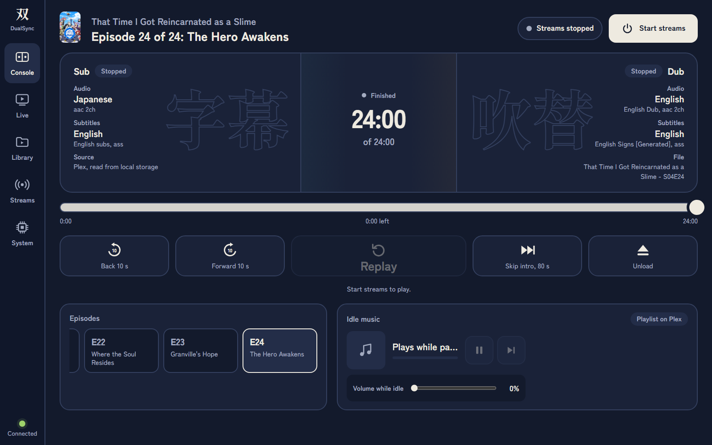
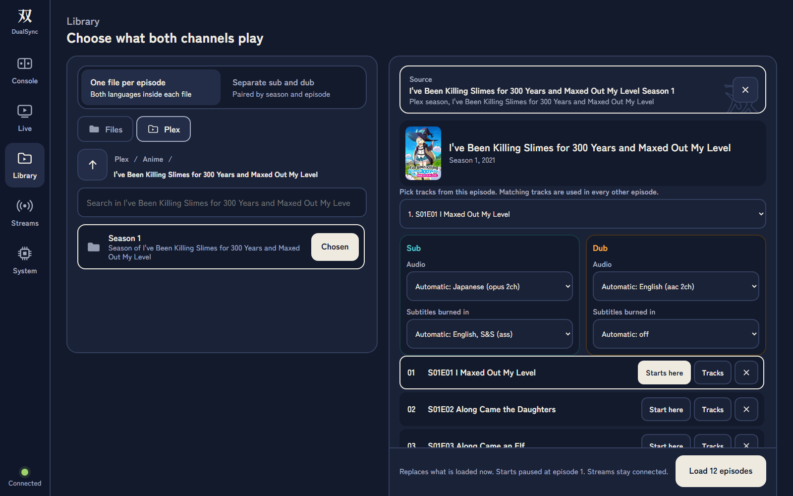
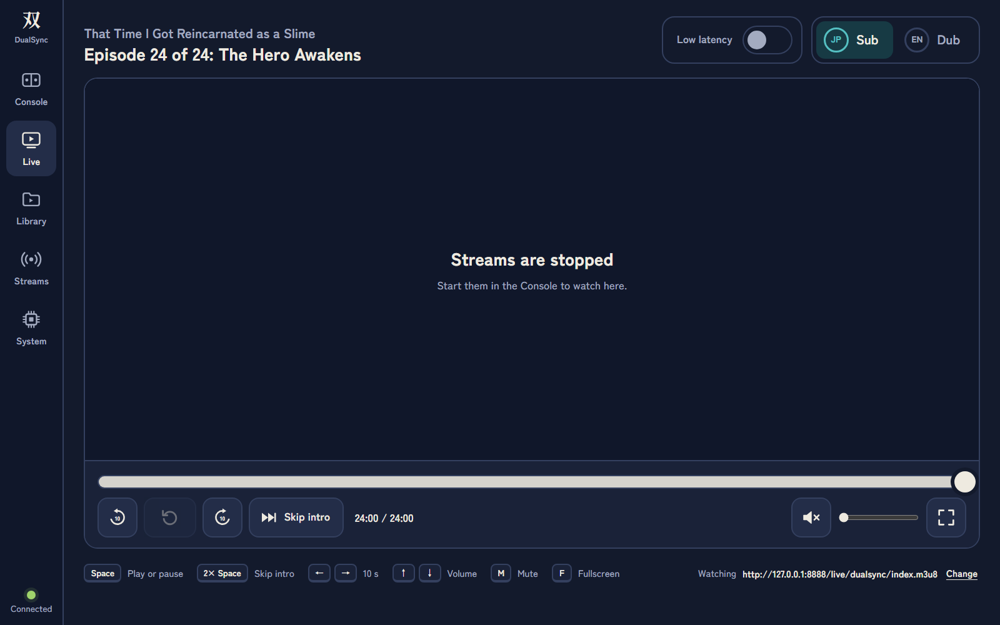
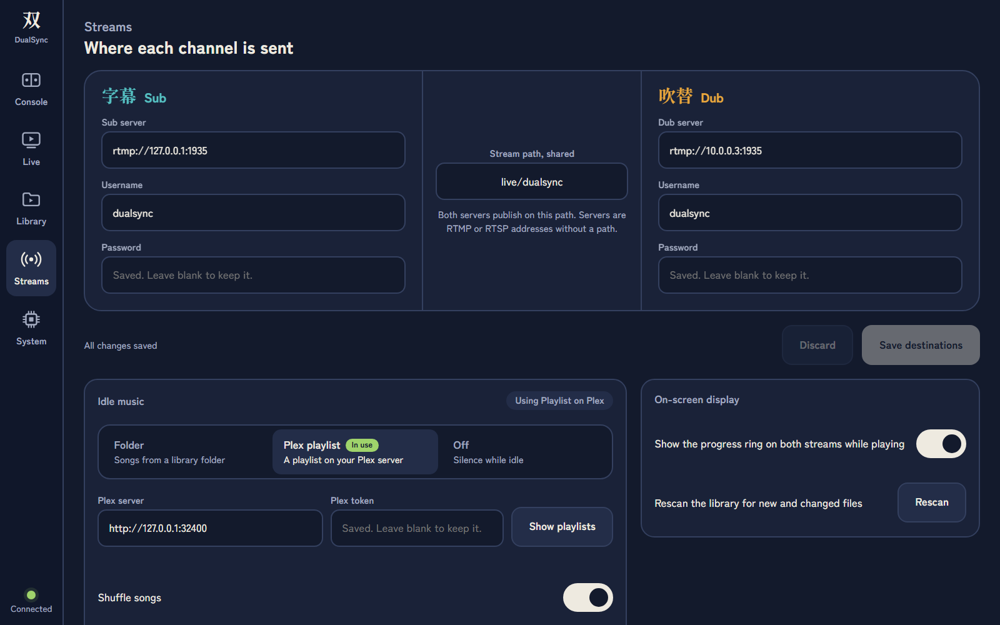
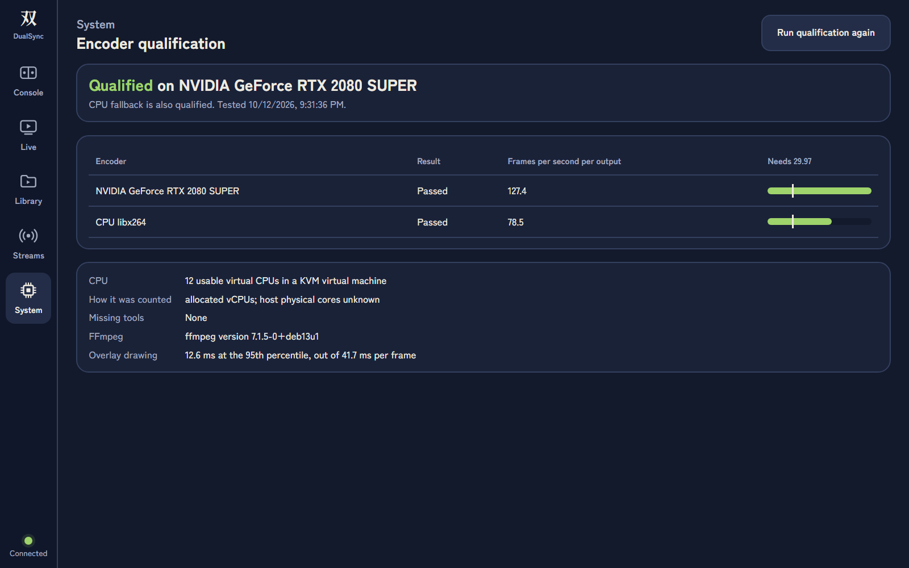
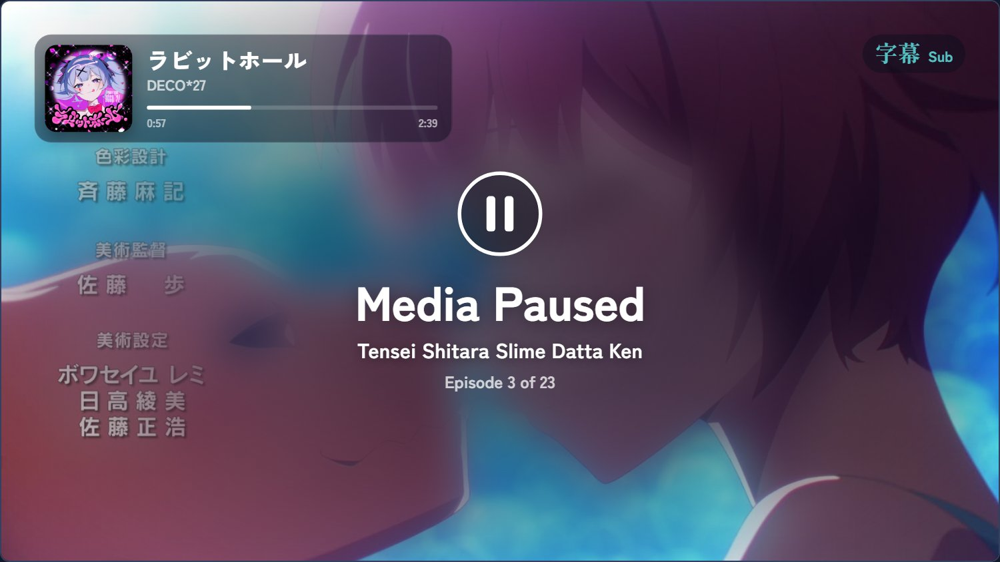

# DualSync

DualSync plays one show to two live streams at once: a **Sub** channel with Japanese audio and burned-in subtitles, and a **Dub** channel with English audio. Both channels run on one clock, so the two audiences always watch the same scene. Pause, seek, skip the intro or change episode, and both streams follow without dropping their connection.

It is a single Go service with a browser control panel. FFmpeg does the decoding, subtitle burn-in and H.264/AAC encoding. Go owns playback state, the HTTP API, idle music and the on-screen broadcast overlays.



## Features

- **Two synchronised outputs.** Each channel publishes to its own RTMP or RTSP server. The FFmpeg publishers stay connected through pause, seek, media changes and playlist changes.
- **Per-channel tracks.** Pick the audio and subtitle track for each channel. Text subtitles (ASS/SRT) and bitmap subtitles (PGS/DVD) are burned in.
- **Local files or Plex.** Browse a media folder or a Plex library. Use one file with both languages, or pair separate Sub and Dub files by season and episode. Local copies are preferred; otherwise media streams from Plex with byte ranges.
- **Broadcast overlays.** The streams show a paused card, a progress ring and a now-playing music card. Transitions are drawn by the compositor, so viewers see them too.
- **Idle music.** While paused, music plays from a folder or a Plex playlist, with shuffle, volume and crossfaded skips.
- **Live view.** Watch either channel inside the panel over HLS. It has a low-latency mode, fullscreen, media keys and keyboard shortcuts (Space, 2× Space to skip the intro, arrow keys, M, F).
- **Encoder qualification.** Every hardware encoder is tested on install. The service prefers NVENC, then Intel QSV, then VAAPI, and falls back to the CPU only when it is fast enough.

## Screenshots

| | |
|---|---|
|  |  |
| **Library.** Choose a folder, a Plex season or one video, then the tracks for each channel. | **Live.** Watch either channel over HLS without leaving the panel. |
|  |  |
| **Streams.** Set the destination servers, idle music and on-screen display. | **System.** View encoder qualification results and run the test again. |

What viewers see on a stream while playback is paused:



## Requirements

- Linux on amd64, with systemd.
- FFmpeg and ffprobe on `PATH`.
- Two RTMP or RTSP servers to publish to, for example [MediaMTX](https://github.com/bluenviron/mediamtx). The Live view expects HLS from the same servers on port 8888. Set `hlsVariant: lowLatency` in MediaMTX for the low-latency mode.
- Optional: an NVIDIA, Intel or AMD GPU for hardware encoding, and a Plex server.
- To build from source: Go 1.26.

There is no Docker dependency.

## Install

Build a release archive (see [Development](#development)), extract it where the service should live, and run the installer:

```sh
tar -xzf dualsync-0.4.0-linux-amd64.tar.gz
cd dualsync
sudo ./install.sh
```

The installer asks for the media root, the listening address, the service account and whether to serve the bundled panel. It writes a systemd unit with absolute paths, so keep the directory in place. To move it, stop the service, move the directory and run the installer again there. Existing configuration is kept.

For a noninteractive installation:

```sh
sudo ./install.sh --noninteractive --media-root /srv/media \
  --listen 0.0.0.0:8090 --service-user dualsync
```

The installer does not install packages or GPU drivers. The service account is added to the existing `video` and `render` groups; parent directories of the media root still need traversal permission. Configuration is stored in `/etc/dualsync`. Credentials, playback state, artwork and diagnostics are stored in `/var/lib/dualsync`. The panel starts on boot; streams start only when you press **Start streams**.

### Encoder qualification

The installer tests every available encoder with two concurrent 30-second 1080p encodes through the publishing path. Each output must contain 720 frames, decode without errors and run at least 1.25× faster than real time. The CPU fallback also needs more than four usable physical cores, or more than four allocated vCPUs in a VM, respecting affinity and CPU quota.

If nothing qualifies, installation stops unless you acknowledge unsupported operation (`--allow-unsupported` when noninteractive). A change of hardware, driver or FFmpeg invalidates the saved result; run the test again from the System view or with `dualsync doctor --encoding-test`.

## Run and configure

```sh
./bin/dualsync --media-root /srv/media --listen 127.0.0.1:8090 \
  --state-dir /var/lib/dualsync
./bin/dualsync doctor --encoding-test --json
```

| Option | Purpose |
|---|---|
| `--config FILE` | Load JSON configuration (see `config.example.json`). Flags override it. |
| `--webroot DIR` | Serve a different panel. Defaults to the installation directory. |
| `--no-webui` | Serve only the API. |
| `--encoder nvenc\|qsv\|vaapi\|cpu`, `--device DEVICE` | Override automatic encoder selection. |
| `--version` | Print the version. |

Set the destinations in the **Streams** view (or `POST /api/settings`) while streams are stopped: one RTMP or RTSP base URL per channel and one shared stream path. Passwords and the Plex token are write-only and never returned by the API.

**Output format:** 1920×1080 at 23.976 fps, H.264 at 8 Mbps, stereo AAC at 48 kHz / 192 kbps. The two sources stay within ten seconds of each other; each viewer's player can add its own buffering on top.

### Serving the panel from another web server

Start the backend with `--no-webui`, bind it to loopback and proxy `/api/*` under the panel's origin. With Caddy:

```caddyfile
:8090 {
    handle /api/* {
        reverse_proxy 127.0.0.1:8091
    }
    handle {
        root * /srv/dualsync/webroot
        file_server
    }
}
```

The API has no CORS support and no authentication. Expose it only to trusted clients on a private network.

## Development

```sh
go test -race ./...
go vet ./...
bash scripts/build-release.sh          # dist/dualsync-0.4.0-linux-amd64.tar.gz + .sha256
```

The release archive contains no saved credentials or server configuration. HTTP tests validate requests and responses against [`api/openapi.yaml`](api/openapi.yaml); regenerate it with `scripts/generate_openapi.py`. Encoder and real-server tests are separate from the deterministic API tests.

The panel in `webroot/` is plain HTML, CSS and JavaScript with no build step. Its only third-party script is [hls.js](https://github.com/video-dev/hls.js) 1.5.20, vendored in `webroot/vendor/` with its licence.

`legacy/python` holds the earlier Python implementation. `dualsync migrate --python-state DIR --media-root ROOT --state-dir NEW_STATE` imports its settings and playlist position into a new state directory without changing the old one.

### Project notes

| Document | Contents |
|---|---|
| [`api/openapi.yaml`](api/openapi.yaml) | The HTTP API contract |
| [`DEPLOYMENT.md`](DEPLOYMENT.md) | Deployment notes |
| [`VALIDATION.md`](VALIDATION.md) | Test results and hardware coverage |
| [`FRONTEND_HANDOFF.md`](FRONTEND_HANDOFF.md), [`FRONTEND_REPORT.md`](FRONTEND_REPORT.md) | Panel API guide and change log |
| [`BROADCAST_UI_REPORT.md`](BROADCAST_UI_REPORT.md) | Broadcast overlay design |
| [`LATENCY_REPORT.md`](LATENCY_REPORT.md), [`MUSIC_QUEUE_REPORT.md`](MUSIC_QUEUE_REPORT.md), [`PLEX_VIDEO_REPORT.md`](PLEX_VIDEO_REPORT.md), [`STARTUP_REPORT.md`](STARTUP_REPORT.md) | Investigations behind specific features |

## Third-party components

- [hls.js](https://github.com/video-dev/hls.js), Apache 2.0, in `webroot/vendor/`.
- [Zen Kaku Gothic New](https://fonts.google.com/specimen/Zen+Kaku+Gothic+New) and [Noto Sans JP](https://fonts.google.com/noto/specimen/Noto+Sans+JP), SIL Open Font License, in `assets/fonts/` and `webroot/fonts/`.
- [FFmpeg](https://ffmpeg.org/) is required at runtime and is not bundled.
